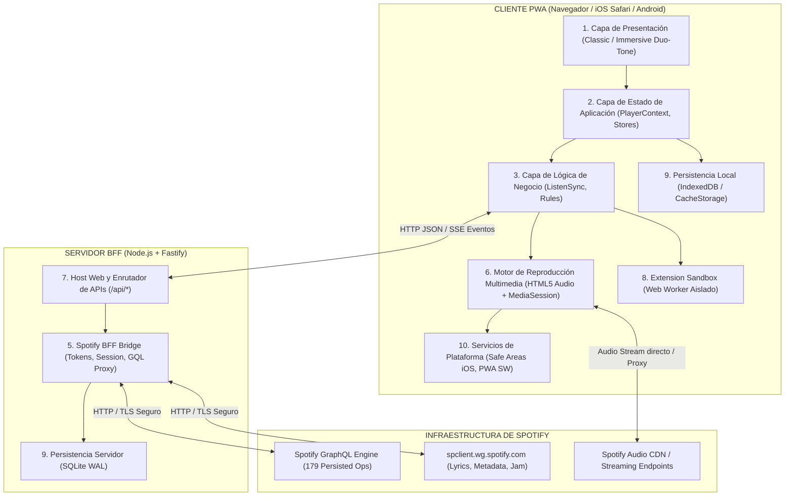

# ARQUITECTURA WEB MODULAR (WEB ARCHITECTURE)
## Myspoti Web / iOS PWA - Port de Orpheon Android
**Referencia:** `kota-zo/Orpheon` (GPL-3.0)
**Patrón Arquitectónico:** Decoupled Hexagonal / Backend-For-Frontend (BFF) + Reactive PWA Client
**Fecha:** Noviembre 2026

---

## 1. Visión General de la Arquitectura

Para satisfacer las 10 Reglas Innegociables del proyecto (cero mocks, paridad estricta con el código fuente Kotlin, preservación de licencias y cero invención), la arquitectura de **Myspoti Web** se organiza en **10 capas desacopladas**.

El sistema elimina las limitaciones impuestas por el navegador (CORS, Same-Origin Policy) desplegando un servicio **Backend-For-Frontend (BFF)** ligero en Node.js/Fastify, que actúa como puente de confianza entre el cliente PWA y los servicios internos de Spotify.



---

## 2. Desglose Detallado de las 10 Capas

### Capa 1: Interfaz y Presentación (UI / UX)
- **Tecnología:** React 18/19, Tailwind CSS, Lucide Icons, Canvas / WebGL Shaders.
- **Modos Visuales Fieles a Compose:**
  1. **Classic Mode:** Jerarquía formal basada en la interfaz original de Spotify (`Theme.kt`), utilizando grises profundos (`#121212`, `#181818`, `#282828`).
  2. **Immersive Mode:** Paridad milimétrica con `com/music/spotui/ui/immersive`:
     - Gradiente dinámico de malla (*mesh gradient*) que flota y respira suavemente en el reproductor.
     - Extracción dinámica de color de la portada (paleta cromática vibrante, oscura y suave).
     - Componentes dedicados: `ImmersivePlayer`, `ImmersiveLyrics`, `ImmersiveQueue`, `ImmersiveMotion`.
  3. **Modo AMOLED:** Fondo negro absoluto (`#000000`) para pantallas OLED, maximizando la eficiencia energética.
- **Diseño Adaptativo Trimodal:**
  - Teléfonos móviles: Navegación inferior ergonómica (*Bottom Navigation Bar*), hojas desplegables (*Bottom Sheets*) y mini-reproductor anclado.
  - Tablets y Escritorio: Barra lateral interactiva (*Sidebar*), vista Bento Grid y panel derecho de actividad/cola.

### Capa 2: Estado de la Aplicación (Application State)
- **Stores Modulares Desacoplados:**
  - `PlayerStore`: Pista activa, estado de reproducción (`playing`, `paused`, `buffering`, `error`), posición de tiempo (`positionMs`), duración (`durationMs`), volumen y modo de repetición/aleatorio.
  - `QueueStore`: Lista de canciones en reproducción actual, cola de usuario (`queued`) y sugerencias siguientes (`nextUp`).
  - `LibraryStore`: Caché en memoria de canciones favoritas (Liked Songs), playlists seguidas, álbumes guardados y estructura de carpetas.
  - `SessionStore`: Estado de autenticación, perfil de usuario actual, país y atributos de cuenta (Free vs Premium).

### Capa 3: Lógica de Negocio (Business Rules)
- Conservación y transcripción exacta de los algoritmos Kotlin:
  - `ListenSyncRules.kt`: Reglas de reconciliación entre la posición del audio local y la señal recibida del servidor, evitando saltos bruscos en conexiones inestables.
  - `RepeatRules.kt`: Máquina de estados para repetición: `OFF -> ALL -> ONE`.
  - `AppShuffle.kt`: Algoritmo de barajado aleatorio que preserva la pista actual en el índice 0 y desordena el resto sin duplicaciones.
  - `PlaylistMerge.kt`: Lógica de deduplicación al insertar álbumes o playlists completas en otra lista.

### Capa 4: Contratos de API (API Contracts)
- Tipado e interfaces que transcriben fielmente `app.myspoti.api.Api.kt`:
  - `MyspotiApi`: Contenedor principal de módulos (`player`, `search`, `catalog`, `library`, `playlists`, `home`, `podcasts`, `users`, `extras`, `devices`, `jam`, `recents`).
  - Modelos de datos equivalentes a `Models.kt`: `Track`, `Album`, `Artist`, `Playlist`, `Show`, `Episode`, `Lyrics`, `Credits`, `Canvas`.

### Capa 5: Integración con Spotify (Spotify BFF Bridge)
- **Proxy Inteligente de GraphQL:**
  - Carga en memoria de `gql-ops.json` (179 operaciones) y `gql-variables.json`.
  - Transmisión de queries con las cabeceras requeridas (`authorization: Bearer <token>`, `client-token: <clientToken>`, `app-platform: WebPlayer`).
- **Mapeador de Endpoints SpClient:**
  - Letras: `GET /color-lyrics/v2/track/{id}`.
  - Metadatos: `GET /metadata/4/track/{hex}`.
  - Radio: `GET /inspiredby-mix/v2/seed_to_playlist`.
  - Connect: `GET /connect/v1/devices`, `POST /connect/transfer`.

### Capa 6: Motor de Reproducción Multimedia (Audio Engine)
- **Arquitectura de Audio Dual y Resiliente:**
  - `AudioEngine.js`: Administra un elemento `<audio>` HTML5 persistente montado en la raíz del documento.
  - Configuración óptima para streaming: `crossOrigin = "anonymous"`, `preload = "auto"`.
  - **Soporte de Fuentes de Audio Múltiples:**
    - Stream de Spotify (vía BFF proxy o Web Playback).
    - Streams alternativos de extensiones (YouTube Music passthrough, SoundCloud, audio directo).
  - **Web Audio API Graph:**
    - Nodo de ecualizador de 5 bandas (`BiquadFilterNode`: 60Hz, 230Hz, 910Hz, 3.6kHz, 14kHz) para emular `EqualizerScreen.kt`.

### Capa 7: Host Web (Web Host)
- Servidor Fastify 4.x / 5.x optimizado para bajo consumo de memoria RAM (<64MB).
- Servidor estático con compresión Gzip/Brotli para servir los assets del cliente (`dist/`).
- Enrutamiento API estructurado: `/api/auth/*`, `/api/spotify/*`, `/api/library/*`, `/api/extensions/*`.

### Capa 8: Sistema de Extensiones (Extensions Sandbox)
- **Aislamiento Seguro en Web Worker:**
  - Los scripts de extensiones se evalúan dentro de un Worker sin acceso al DOM ni a credenciales de red.
  - Protocolo de mensajería asíncrona:
    ```typescript
    interface ExtensionRequest {
      id: string;
      action: 'resolveAudio' | 'getLyrics' | 'resolveDownload';
      payload: { trackUri: string; isrc?: string; title?: string; artist?: string };
    }
    ```

### Capa 9: Persistencia y Almacenamiento (Persistence)
- **Servidor (BFF):** Base de datos SQLite local en modo WAL (Write-Ahead Logging) para almacenar metadatos de usuario, configuraciones y caché de búsquedas frecuentes.
- **Cliente (PWA):**
  - `IndexedDB`: Almacenamiento de pistas locales, historial reciente y caché de letras.
  - `CacheStorage`: Almacenamiento de recursos estáticos de la aplicación (Shell PWA) gestionado por el Service Worker.

### Capa 10: Servicios Específicos de Plataforma (Platform Services)
- **W3C Media Session API:**
  - Handlers de control: `play`, `pause`, `previoustrack`, `nexttrack`, `seekto`.
  - Sincronización continua de metadatos con carátulas en múltiples resoluciones.
- **Optimizaciones iOS Safari:**
  - Soporte de CSS `env(safe-area-inset-top)` y `env(safe-area-inset-bottom)`.
  - Atributos PWA en `index.html`:
    - `<meta name="apple-mobile-web-app-capable" content="yes">`
    - `<meta name="apple-mobile-web-app-status-bar-style" content="black-translucent">`

---

## 3. Seguridad y Privacidad

1. **Blindaje de Credenciales:**
   - Ningún token de acceso, cookie privada ni secreto de autenticación se expone de forma abierta en el código cliente.
   - Las cookies de sesión son gestionadas por el BFF con atributos `HttpOnly`, `Secure` y `SameSite=Lax`.
2. **Cero Mocks en Producción:**
   - Toda llamada en entorno de producción se conecta con endpoints reales de Spotify a través del BFF.
